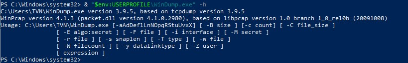
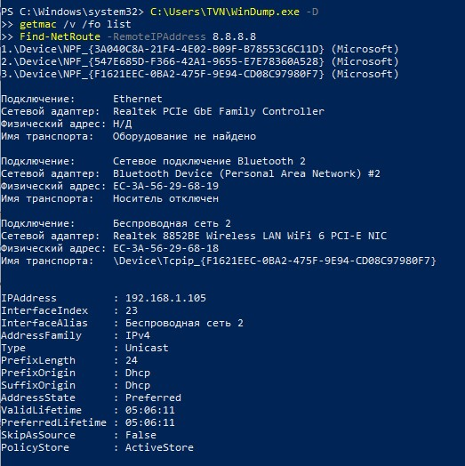
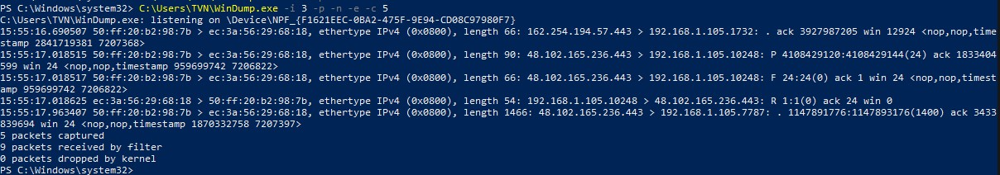
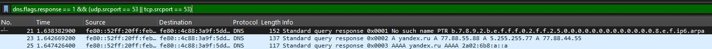

# Захват и фильтрация сетевого трафика

Практическая работа по дисциплине «Защита компьютерных сетей и систем». Тема 2 — «Модель OSI и модель TCP/IP».

**Студент** Кудрявцев Тихон Александрович  
**Группа** МКБ261  
**Дата** 22.11.2026  
**Преподаватель** Денис Бубнов

Цель работы — захватить трафик в WinDump и Wireshark, определить адреса компьютера и основного шлюза, записать отдельные дампы и проверить действие фильтров.

## Задание 1. Захват и фильтрация в WinDump

### 1.1. Запуск WinDump и проверка справки

Команда PowerShell открывает встроенную справку WinDump.

```powershell
& "$env:USERPROFILE\WinDump.exe" -h
```

В выводе видны WinDump **3.9.5**, WinPcap **4.1.3** и строка `Usage` с параметрами. Для задания 2 использован Wireshark **4.6.10**, что подтверждается метаданными PCAPNG.



*Рисунок 1. Справка WinDump.*

### 1.2. Определение интерфейса и пробный захват

```powershell
C:\Users\TVN\WinDump.exe -D
getmac /v /fo list
Find-NetRoute -RemoteIPAddress 8.8.8.8
```

| Параметр | Значение |
| --- | --- |
| Имя интерфейса Windows | Беспроводная сеть 2 |
| Индекс интерфейса Windows | `23` |
| Номер интерфейса WinDump | `3` |
| GUID интерфейса | `{F1621EEC-0BA2-475F-9E94-CD08C97980F7}` |
| IPv4 компьютера | `192.168.1.105` |
| IPv4 основного шлюза | `192.168.1.1` |

В результатах `getmac` и `WinDump.exe -D` совпал GUID. В выводе `Find-NetRoute` для маршрута к `8.8.8.8` указан интерфейс «Беспроводная сеть 2». Для захвата выбран его номер в WinDump — `3`.



*Рисунок 2. Сопоставление интерфейса Windows с интерфейсом № 3 в WinDump.*

```powershell
C:\Users\TVN\WinDump.exe -i 3 -p -n -e -c 5
```

В пробном захвате получено **5 пакетов**. WinDump вывел строки с Ethernet-заголовками и сообщил `0 packets dropped by kernel`.



*Рисунок 3. Захват пяти пакетов на выбранном интерфейсе.*

### 1.3. Захват 200 пакетов и вывод в консоль

Команда выводит подробности захвата в консоль.

```powershell
C:\Users\TVN\WinDump.exe -i 3 -p -vv -n -e -c 200
```

Для записи вывода в текстовый файл использован `Tee-Object`.

```powershell
C:\Users\TVN\WinDump.exe -i 3 -p -vv -n -e -l -c 200 | Tee-Object -FilePath C:\Users\TVN\OSI_TCP-IP\console_200.txt
```

| Параметр | Назначение |
| --- | --- |
| `-i 3` | Захват на интерфейсе № 3 |
| `-p` | Захват без promiscuous-режима |
| `-vv` | Повышенная детализация вывода |
| `-n` | Вывод числовых адресов без разрешения имён |
| `-e` | Вывод заголовка Ethernet |
| `-c 200` | Остановка после 200 пакетов |
| `-l` | Построчное буферизование консольного вывода |

В [console_200.txt](attachments/console_200.txt) проверено **ровно 200 пакетных записей**. В каждой есть Ethernet-заголовок, а в подробном выводе IPv4 видны дополнительные поля заголовка, включая TTL и идентификатор.

### 1.4. MAC-адреса компьютера и основного шлюза

В первой строке `console_200.txt` видны оба MAC-адреса.

```text
14:25:24.868222 ec:3a:56:29:68:18 > 50:ff:20:b2:98:7b, ethertype IPv4 (0x0800)
```

| Устройство | IPv4 | MAC |
| --- | --- | --- |
| Компьютер | `192.168.1.105` | `EC:3A:56:29:68:18` |
| Основной шлюз | `192.168.1.1` | `50:FF:20:B2:98:7B` |

В исходящем Ethernet-кадре слева показан MAC отправителя, справа — MAC следующего узла. Для сверки MAC шлюза использована запись `LinkLayerAddress` в таблице соседей Windows. Команда приведена с фактическими значениями индекса и адреса.

```powershell
Get-NetNeighbor -InterfaceIndex 23 -IPAddress 192.168.1.1
```

### 1.5. Захват трафика, сформированного маршрутизатором

```powershell
C:\Users\TVN\WinDump.exe -i 3 -p -n -s 0 -w C:\Users\TVN\OSI_TCP-IP\01_gateway.pcap 'ether src 50:FF:20:B2:98:7B and ether dst EC:3A:56:29:68:18 and (ip src host 192.168.1.1 or arp src host 192.168.1.1)'
```

Трафик формировался командой `ping 192.168.1.1` в другом окне. Для записи использован параметр `-w`. Фильтр проверяет MAC отправителя, MAC получателя и адрес источника в IPv4 или ARP. Если шлюз пересылает компьютеру ответ внешнего сервера, в Ethernet отправителем указан шлюз, а внутри IP-пакета остаётся адрес внешнего сервера. Условие `ip src host 192.168.1.1` исключает такие пересланные ответы.

В [01_gateway.pcap](attachments/01_gateway.pcap) сохранены **9 кадров**. Восемь — `ICMP Echo Reply` с IPv4-источником `192.168.1.1`. Кадр № 7 — ARP-запрос, в котором `192.168.1.1` запрашивает MAC для `192.168.1.105`. У всех девяти кадров Ethernet-отправитель и получатель совпадают с MAC шлюза и компьютера соответственно. Размер файла — **802 байта**.

### 1.6. Захват ICMP к 8.8.8.8

Команда захвата в первом окне PowerShell.

```powershell
C:\Users\TVN\WinDump.exe -i 3 -p -n -s 0 -w C:\Users\TVN\OSI_TCP-IP\02_icmp.pcap 'icmp and host 8.8.8.8'
```

Во втором окне запускался `ping`.

```powershell
ping 8.8.8.8
```

Фильтр `icmp and host 8.8.8.8` пропускает ICMP-пакеты с адресом `8.8.8.8` в качестве источника или назначения. В [02_icmp.pcap](attachments/02_icmp.pcap) найдено **8 пакетов** — 4 исходящих `Echo Request` (тип 8) и 4 входящих `Echo Reply` (тип 0). Запросы и ответы совпадают по номерам последовательности 9–12. Время от запроса до ответа по меткам захвата составило **27,8–28,9 мс**. Размер файла — **744 байта**.

## Задание 2. Захват и фильтрация в Wireshark

### 2.1. Проверка файлов WinDump

Оба файла прочитаны в формате **PCAP 2.4 с Ethernet-кадрами**. В `01_gateway.pcap` проверены Ethernet-адреса и поля источника IPv4/ARP, в `02_icmp.pcap` — типы, направления и номера последовательности ICMP. Для визуальной проверки в Wireshark файлы открываются через **Файл → Открыть** (`Ctrl+O`).

### 2.2. Выбор интерфейса в Wireshark

В метаданных [task_2.pcapng](attachments/task_2.pcapng) указан интерфейс **«Беспроводная сеть 2»** с тем же GUID, который был сопоставлен с интерфейсом № 3 в WinDump. Список пакетов захвата отображается в Wireshark на рисунке 4.

### 2.3. Захват DNS и HTTPS с ограничением на 50 пакетов

Перед запуском захвата в **Захват → Параметры** (`Ctrl+K`) выбран интерфейс и задан фильтр захвата. Выражение сохранено в метаданных PCAPNG.

```text
udp port 53 or tcp port 53 or tcp port 443
```

В параметрах автоостановки задано **50 пакетов**. DNS отбирался по порту 53, HTTPS по TCP — по порту 443.

| Трафик | Пакеты | Что найдено |
| --- | ---: | --- |
| DNS по UDP/53 | 6 | 3 запроса и 3 ответа |
| TCP/443 | 44 | Сегменты HTTPS-соединений, включая TLS Client Hello и Server Hello |
| **Всего** | **50** | Все пакеты соответствуют фильтру захвата |

### 2.4. Отображение ответов DNS и сохранение PCAPNG

В Wireshark применён фильтр отображения ответов DNS с порта 53.

```text
dns.flags.response == 1 && (udp.srcport == 53 || tcp.srcport == 53)
```

Он отобрал **3 ответа DNS**. Они пришли с порта `53` от `fe80::52ff:20ff:feb2:987b` к клиенту `fe80::4c88:3a9f:5dd:ee3c`.

| Кадр | Запись | Содержимое ответа |
| --- | --- | --- |
| 21 | PTR | `NXDOMAIN`, обратное имя отсутствует |
| 23 | A для `yandex.ru` | `77.88.55.88`, `5.255.255.77`, `77.88.44.55` |
| 25 | AAAA для `yandex.ru` | `2a02:6b8:a::a` |



*Рисунок 4. Фильтр отображения и три ответа от DNS-сервера.*

На скриншоте видны строки, отобранные фильтром отображения. В файле [task_2.pcapng](attachments/task_2.pcapng) сохранён **весь захват из 50 пакетов**. Размер файла — **16 320 байт**.

## Чек-лист самопроверки

| № | Проверка | Результат |
| ---: | --- | --- |
| 1 | Установка и запуск WinDump и Wireshark | Подтверждено справкой WinDump, окном Wireshark и метаданными PCAPNG. |
| 2 | Выбор интерфейса и работа захвата | Подтверждено совпадением GUID и пробным захватом 5 пакетов с нулём потерь на уровне ядра. |
| 3 | Консольный захват с нужными параметрами | В `console_200.txt` ровно 200 пакетных записей. В выводе есть Ethernet-адреса, числовые IP и подробные поля заголовков. Команда приведена в п. 1.3. |
| 4 | Определение MAC-адресов | Оба MAC видны в Ethernet-заголовке. Адрес шлюза совпадает с таблицей соседей Windows. |
| 5 | Сохранение дампа маршрутизатора | `01_gateway.pcap` содержит 9 кадров и занимает 802 байта. Адрес источника шлюза проверен внутри IPv4 или ARP. |
| 6 | Захват ICMP на `8.8.8.8` | В приложенном `02_icmp.pcap` проверены 4 запроса и 4 ответа. |
| 7 | Открытие и содержание дампов WinDump в Wireshark | Формат и содержимое обоих PCAP проверены. Визуальное открытие обоих файлов в Wireshark следует подтвердить на своём ПК. |
| 8 | Интерфейс Wireshark и наличие пакетов | Интерфейс совпадает с выбранным в задании 1. Захваченные пакеты видны на рисунке 4. |
| 9 | Параметры фильтра и число пакетов | Текст фильтра подтверждён метаданными PCAPNG. В дампе 50 пакетов, все соответствуют условиям фильтра. |
| 10 | Фильтр DNS-ответов и сохранение PCAPNG | На скриншоте три ответа DNS с порта 53. Приложенный PCAPNG содержит полный набор из 50 пакетов. |
| 11 | Проверка файла, ссылка в LMS и доступ | `task_2.pcapng` прочитан, содержимое и ненулевой размер подтверждены. Публикация ссылки в LMS и права доступа требуют проверки при сдаче. |

## Приложения

- [console_200.txt](attachments/console_200.txt) — полный вывод WinDump для 200 пакетов.
- [01_gateway.pcap](attachments/01_gateway.pcap) — захват кадров, сформированных маршрутизатором.
- [02_icmp.pcap](attachments/02_icmp.pcap) — ICMP к `8.8.8.8` и ответы от него.
- [task_2.pcapng](attachments/task_2.pcapng) — полный захват DNS и HTTPS в Wireshark.

